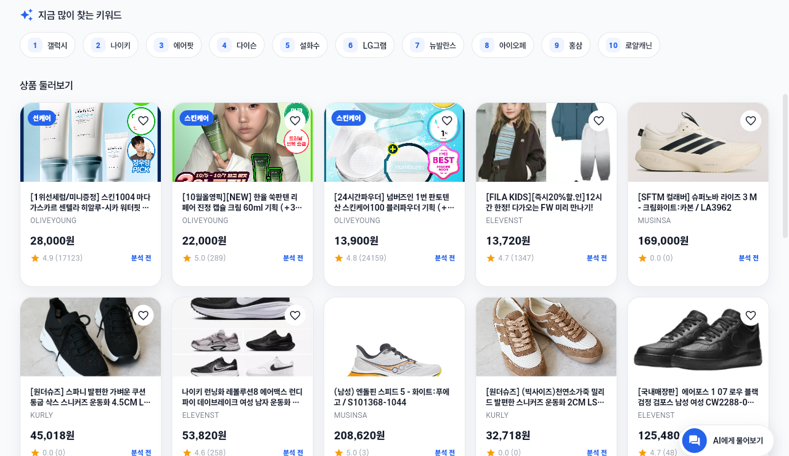
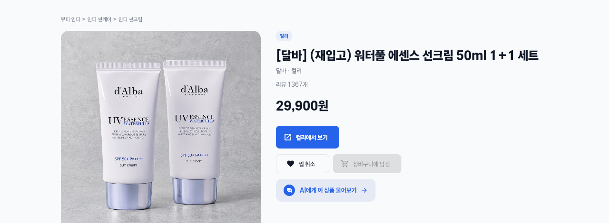
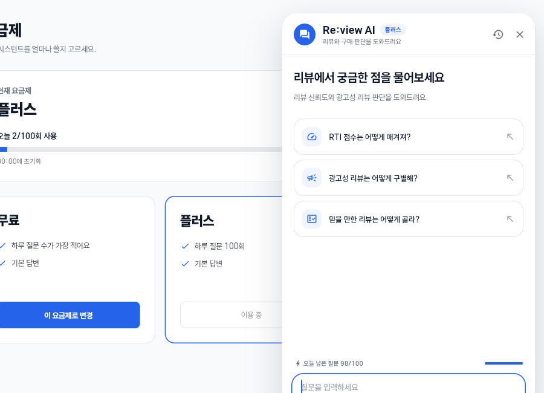

<p align="center">
  
</p>

<h1 align="center">Re:view</h1>

<p align="center">
  <b>상품 탐색부터 리뷰·가격 비교와 상품 문맥 채팅까지 연결하는 쇼핑 신뢰도 분석 서비스</b>
</p>

<p align="center">
  
  
  
  
  
  
</p>

<p align="center">
  <a href="https://re-view.kr">운영 웹</a> ·
  <a href="#running-locally">실행 방법</a> ·
  <a href="#environment-variables">환경변수</a> ·
  <a href="#communication-pipeline">통신 흐름</a> ·
  <a href="#screens">화면</a> ·
  <a href="#data-contracts">데이터 계약</a>
</p>

| 홈: 실제 상품 목록 | 상품 v2 상세 | 계정·플랜 |
| --- | --- | --- |
|  |  |  |

2026-10-06 검증 당시의 웹 화면입니다. 상품·가격·사용량은 서버 응답에 따라 달라집니다.

## Overview

Re:view는 실사용 리뷰 기반 쇼핑 신뢰도 분석 서비스입니다. 상품을 찾고 리뷰와 분석 상태를 확인한 뒤, 가격 비교·찜·장바구니·상품 문맥 채팅으로 탐색을 이어갑니다.

이 저장소는 Flutter 프론트엔드입니다. 상품·계정·분석 결과는 API에서 받아 표시하며, 분석되지 않은 상품은 **분석 전**으로 구분합니다. 웹은 [re-view.kr](https://re-view.kr)에서 운영하며 Android/iOS 앱은 출시 준비 중입니다.

공통 헤더와 검색 상태를 유지하며 본문을 전환합니다. 계정 화면은 공통 메뉴 안에서 스크롤하며, 설정의 **움직임 줄이기**를 켜면 전환·카드·갤러리 효과와 반복 로딩 모션을 줄입니다. 모바일 웹에서는 헤더, 필터, 상품 카드와 채팅 패널이 화면 폭에 맞춰 배치됩니다.

## Running Locally

로컬 `flutter --version` 확인 기준은 **Flutter 3.44.2 / Dart 3.12.2**입니다. `pubspec.yaml`은 Dart **^3.11.4**를 요구합니다. 아래 명령은 저장소 루트 기준입니다.

```bash
flutter pub get
flutter devices
```

### Web

```bash
flutter run -d chrome
```

로컬 웹은 기본적으로 `https://api.re-view.kr`에 직접 연결합니다. 운영 웹은 같은 출처의 `/api/*`를 호출하며 `vercel.json`의 rewrite로 API 서버에 전달합니다. `flutter run` 자체는 Vercel 프록시를 제공하지 않습니다.

### Android Emulator

Android SDK와 JDK 17을 준비하고 에뮬레이터를 실행한 뒤 `flutter devices`의 기기 ID를 사용합니다.

```bash
flutter emulators
flutter run -d <ANDROID_DEVICE_ID>
```

### iOS Simulator

macOS·Xcode·CocoaPods가 필요합니다. `flutter pub get` 이후 iOS 의존성을 설치하고 Simulator를 실행합니다.

```bash
cd ios
pod install
cd ..
open -a Simulator
flutter devices
flutter run -d <IOS_SIMULATOR_ID>
```

### Physical Device

Android는 USB 디버깅, iOS는 개발자 모드·컴퓨터 신뢰와 Xcode의 서명 팀 설정을 준비합니다. 연결한 기기를 `flutter devices`에서 확인합니다.

```bash
flutter run -d <PHONE_DEVICE_ID>
```

위 기기 ID 자리는 실제 출력값으로 바꿉니다. 앱의 기본 API 주소는 `https://api.re-view.kr`입니다. 실행 절차를 안내한 것이며 네이티브 빌드·실기기 동작 검증 결과는 아닙니다.

### Environment Variables

`lib/core/config/app_config.dart`의 주요 `String.fromEnvironment` 키입니다. 실행 시 `--dart-define`으로 전달하며 변경 후에는 앱을 다시 실행합니다. `.env` 파일 자동 로드는 구현되어 있지 않습니다.

| 키 | 용도 | 생략 시 기본값 |
| --- | --- | --- |
| `API_BASE_URL` | API 루트 주소 | 운영 웹: 현재 origin, 로컬 웹·앱: `https://api.re-view.kr` |
| `HOME_DASHBOARD_PATH` | 홈 대시보드 | `/api/dashboard` |
| `SEARCH_PATH` | 상품 검색 | `/api/products` |
| `PRODUCT_PATH` | 기존 상품 조회 | `/api/products` |
| `ANALYSIS_PATH` | 상품 분석 | `/api/analysis/product` |
| `ANALYSIS_HEALTH_PATH` | 분석 상태 확인 | `/api/analysis/health` |
| `LOGIN_PATH` | 이메일 로그인 | `/api/auth/login` |
| `SIGNUP_PATH` | 회원가입 | `/api/auth/signup` |
| `LOGOUT_PATH` | 로그아웃 | `/api/auth/logout` |
| `GOOGLE_OAUTH_PATH` | Google 로그인 시작 | `/oauth2/authorization/google` |
| `NAVER_OAUTH_PATH` | 네이버 로그인 시작 | `/oauth2/authorization/naver` |
| `USER_ME_PATH` | 현재 사용자 | `/api/users/me` |
| `USER_SETTINGS_PATH` | 사용자 설정 | `/api/users/me/settings` |
| `CHAT_BASE_PATH` | 채팅·사용량 | `/api/chat` |
| `NOTIFICATION_BASE_PATH` | 알림함 | `/api/notifications` |
| `REPORT_BASE_PATH` | 리뷰 신고 | `/api/reports` |

`API_BASE_URL`에는 `/api`를 붙이지 않습니다. 각 경로의 기본값에 이미 `/api`가 포함되어 있습니다. 로컬 웹 판별 호스트는 `localhost`, `127.0.0.1`, `::1`, `*.localhost`입니다.

```bash
flutter run -d chrome --dart-define=API_BASE_URL=https://api.re-view.kr
```

### 로컬 백엔드 주소

아래는 개발 PC에 별도로 실행한 백엔드에 연결할 때의 **주소 예시**입니다. `PORT`는 실제 백엔드 포트로 바꿉니다. 이 저장소에는 로컬 백엔드 실행 설정과 고정 포트가 없습니다.

| 실행 환경 | `API_BASE_URL` 예시 |
| --- | --- |
| 같은 PC의 웹 브라우저 | `http://localhost:PORT` |
| Android Emulator | `http://10.0.2.2:PORT` |
| iOS Simulator | `http://127.0.0.1:PORT` |
| Android / iOS 실기기 | `http://<PC의_LAN_IP>:PORT` |

실기기의 `localhost`는 휴대폰 자신을 가리킵니다. PC와 같은 네트워크에서 접근 가능한 주소를 사용하고 서버의 바인딩·방화벽·CORS를 확인합니다. HTTP 주소는 예시이며 현재 네이티브 보안 설정에서 접속을 검증하지 않았습니다.

## Problem / Solution

| Problem | Solution |
| --- | --- |
| 여러 쇼핑몰 상품과 리뷰를 오가며 비교해야 함 | 상품 검색·상세·가격 비교·저장 기능을 공통 탐색 흐름으로 연결 |
| 분석 결과가 없는 상품을 점수만으로 판단하기 어려움 | null은 분석 전, 실제 0점은 0점으로 구분 |
| 상품 맥락을 대화에 다시 설명해야 함 | 외부 상품 식별자를 유지해 상품 문맥 채팅으로 전달 |
| 비동기 수집·검색 중 결과 상태를 알기 어려움 | 수집 대기·로딩·실패·재시도와 리뷰 더 불러오기 제공 |

## Platform Support

| Platform | 상태 | 현재 최소 버전·설정 |
| --- | --- | --- |
| Web | [re-view.kr](https://re-view.kr) 운영 | Flutter Web. 최소 브라우저 버전은 저장소에 명시되어 있지 않음 |
| Android | 출시 준비 중 | `android/app/build.gradle.kts`의 `minSdk = flutter.minSdkVersion`. 로컬 Flutter 3.44.2 SDK 기본값은 API 24이며 프로젝트에서 숫자를 고정하지 않음 |
| iOS | 출시 준비 중 | Xcode 프로젝트의 `IPHONEOS_DEPLOYMENT_TARGET` 기준 iOS 13.0. Podfile의 전역 platform 선언은 주석 상태 |

네이티브 프로젝트 포함 여부와 실제 배포 검증은 구분합니다. 아래 기존 QA 기록은 웹 기준입니다.

## Core Features

- 상품 검색, 카테고리 탐색, 기존 상품·외부 상품 v2 상세와 리뷰 페이징
- 리뷰 신뢰도·분석 전 상태 표시, 상품 이미지 갤러리와 가격 비교
- 찜·장바구니, 최근 본 상품, 계정·플랜·사용량 조회
- 일반·프로 상품 문맥 채팅과 대화 기록
- 이메일 로그인·회원가입·비밀번호 재설정, 웹 Google/네이버 OAuth, 온보딩
- 리뷰 신고·피드백·알림함, 설정과 움직임 줄이기
- 관리자 리뷰·신고·사용자·배너 관리 화면
- 웹 전용 TEST 결제 화면과 서버 계약 경계: 키·API 미설정 시 비활성화

## Tech Stack

| 영역 | 기술·구성 |
| --- | --- |
| Client | Flutter / Dart, Web·Android·iOS 프로젝트 |
| State / DI | `flutter_riverpod` |
| Navigation | `go_router`, 공통 shell·인증 라우팅 |
| HTTP | `dio`, 수동 DTO 파싱, 공통 `Result` / `Failure` |
| Storage | `flutter_secure_storage`, `shared_preferences`, 웹·네이티브 조건부 구현 |
| UI | Material, Freesentation, `shimmer`, `flutter_typeahead` |
| Localization | `flutter_localizations`, `intl`, ARB |
| Utilities | `url_launcher`, `file_picker` |
| Tests | `flutter_test`, `mocktail` |
| Web Deployment | GitHub Actions, Vercel CLI, rewrite·SPA fallback |

기능별 data/domain/presentation 계층을 분리합니다. DTO는 수동 파싱하고 공통 `Result`·`Failure`로 오류를 전달합니다.

```text
lib/
├── main.dart                    # 저장소 초기화·앱 시작
├── app/                         # shell·router·반응형 배치·테마·모션
├── core/                        # 설정·네트워크·저장소·공통 provider
├── features/
│   └── <feature>/
│       ├── data/                # datasource·DTO·repository 구현
│       ├── domain/              # entity·repository·use case
│       └── presentation/        # page·widget·provider·view model
├── shared/                      # 공통 위젯·상수·확장
└── l10n/                        # ARB·생성된 번역 코드

test/                            # 도메인·데이터·상태·위젯 회귀 검증
```

주요 기능 디렉터리는 `home`, `search`, `product_detail`, `external_product`, `auth`, `chat`, `plan`, `my_page`, `wishlist`, `cart`, `review_report`, `notifications`, `settings`, `admin`입니다. 기능마다 필요한 계층만 둡니다.

## Communication Pipeline

`AppConfig`, `ApiClient`, 루트·웹 `vercel.json`에서 확인한 프론트 통신 경로입니다.

```text
브라우저
  ├─ 운영: https://re-view.kr (Vercel)
  │    ├─ /api/*          ── rewrite ──> https://api.re-view.kr/api/*
  │    ├─ /oauth2/*       ── rewrite ──> https://api.re-view.kr/oauth2/*
  │    └─ /login/oauth2/* ── rewrite ──> https://api.re-view.kr/login/oauth2/*
  └─ localhost 개발 ──────────────────> https://api.re-view.kr

Android / iOS 앱 ── HTTPS 직접 호출 ──> https://api.re-view.kr
                                          │
                                          ├─ 상품·리뷰·수집 job 조회
                                          ├─ 계정·플랜·알림·신고
                                          └─ POST /api/chat/messages
                                             POST /api/chat/pro/messages
                                             → JSON 응답

인증 요청: Authorization: <tokenType> <accessToken>
  └─ 인증 토큰을 보낸 일반 API 요청이 401
       └─ POST /api/auth/refresh
            ├─ 새 accessToken·tokenType 저장 → 원래 요청 1회 재시도
            └─ refresh 또는 재시도 401 → 현재 세션 만료 처리
```

동시 401은 진행 중인 refresh 요청을 공유합니다. `/api/auth/*`, 토큰 없는 요청, 이미 재시도한 요청에는 같은 갱신 루프를 반복하지 않습니다. refresh 요청은 현재 코드에서 본문 없이 전송합니다. OAuth는 웹 리다이렉트 구현이며 네이티브 이동 구현은 아직 지원되지 않습니다.


### 서비스 전체 구성

프론트 뒤의 서버 구성입니다. 각 저장소(review-backend, review-data, review-ai-db)의 배포 설정과 도메인 기준이며, 프론트는 Spring API만 호출합니다.

```text
re-view.kr (Vercel, Flutter Web)
  │ /api/* · /oauth2/* 프록시
  ▼
api.re-view.kr  Spring Boot API ── AWS EC2 (nginx → Docker)
  ├─ PostgreSQL (RDS) · Redis (리프레시 토큰)
  ├─ Google · Naver OAuth2
  ├─ LLM 게이트웨이 (상품 채팅 답변)
  │
  │ REST + 내부 토큰 (카탈로그 동기화, 상품·검색·수집 job 조회)
  ▼
data.re-view.kr  Data API ── GCP VM (Docker Compose, Caddy)
  ├─ 스케줄러 → 수집 워커 (쇼핑몰 상품·리뷰 수집)
  ├─ 분석 워커 ×2 · PostgreSQL 16
  │
  │ POST /api/v1/data/analyze/stream → SSE 응답 (내부 토큰)
  ▼
ai.re-view.kr  AI 분석 API ── GCP VM (KoELECTRA 기반 RTI, MySQL 8.0)
```

분석 결과는 Spring이 상품을 조회할 때 Data API에서 함께 받아 전달합니다(완료 웹훅이 아니라 조회 방식).

## Screens

기존 `.github/qa`의 웹 캡처입니다. 촬영 시점의 화면이므로 현재 데이터·문구·배치와 다를 수 있습니다.

| 화면 | 경로·역할 | 기존 캡처 |
| --- | --- | --- |
| 홈 | `/` — 상품·카테고리 탐색 | [데스크톱](.github/qa/2026-10-06/home-desktop.png) · [모바일 웹](.github/qa/2026-10-06/home-mobile.png) |
| 상품 상세 | `/product/:id`, `/product/:platform/:productId` — 리뷰·분석·가격 확인 | [데스크톱](.github/qa/2026-10-06/product-desktop.png) · [모바일 웹](.github/qa/2026-10-06/product-mobile.png) |
| 플랜 | `/plan` — 현재 플랜·사용량 | [데스크톱](.github/qa/2026-10-06/plan-desktop.png) · [모바일 웹](.github/qa/2026-10-06/plan-mobile.png) |
| 로그인 | `/login` — 이메일·소셜 로그인 | [데스크톱](.github/qa/2026-10-07/login-desktop.png) · [모바일 웹](.github/qa/2026-10-07/login-mobile.png) |
| 상품 채팅 | 상품 화면의 채팅 패널 | [데스크톱](.github/qa/2026-10-07/product-chat-desktop.png) · [모바일 웹](.github/qa/2026-10-07/product-chat-mobile.png) |

## Deployment

`develop` 머지와 PR push는 분석·release 컴파일만 수행합니다. 요청한 작업을 모두 끝낸 뒤 최종 SHA를 지정한 수동 배포를 한 번 실행합니다. main 릴리스/태그는 별도 QA 조건을 따릅니다.

| 경로 | 빌드·설정 |
| --- | --- |
| GitHub Actions `.github/workflows/vercel-deploy.yml` | PR/develop push는 배포 없는 `deploy-preview` validation(분석·release 빌드). `workflow_dispatch`로 최종 develop SHA를 지정한 경우에만 SHA 재확인·표식 작성 뒤 `build/web`을 한 번 production 배포. `web/vercel.json` 사용 |
| Vercel Git integration | `git.deploymentEnabled:false`로 자동 배포 차단. 기존 `build.sh`/rewrite/도메인 설정은 보존하고 최종 배포에는 Actions CLI 경로만 사용 |

양쪽 설정은 `/api`, OAuth 시작·콜백을 API 서버로 연결하고 SPA fallback을 제공합니다. 서버 CORS 제약으로 preview 도메인의 실제 로그인은 운영과 다를 수 있습니다.

자동 PR preview 및 자동 production 배포를 하지 않습니다. Vercel 프로젝트의 preview 자동 생성도 비활성화하며 루트와 웹 배포 설정 모두 `git.deploymentEnabled:false`를 유지합니다. `Ignored Build Step`으로 취소해도 배포 한도를 소비하므로 자동 배포 차단의 대안으로 사용하지 않습니다. 기존 `deploy-preview` 검사명은 호환을 위해 유지하지만 배포 없는 분석·release 빌드 검사라는 의미입니다. 최종 단일 Actions production 이후 [운영 deployment.json](https://re-view.kr/deployment.json)의 HTTP200/`Cache-Control:no-store`/`commitSha`가 최종 `origin/develop`과 같은지 확인합니다.

Actions 화면에서 `Validate Flutter Web and Final Deployment`를 선택하고 `develop`의 최종 40자리 SHA를 `commit_sha`로 입력해 수동 실행합니다. 실행 후 아래 응답 헤더·본문을 확인하고 `commitSha`를 배포 대상으로 지정한 SHA 및 최종 `origin/develop`과 비교합니다.

```bash
curl -i https://re-view.kr/deployment.json
```

기대 응답은 HTTP 200, `Cache-Control: no-store`, 본문의 `commitSha`입니다. 이 절차는 배포 안내이며 이번 README 수정에서 배포를 실행하지 않았습니다.

## Data Contracts

아래는 기존 상품·계정·채팅·결제 계약과 당시 검증 기록입니다. 과거 QA 수치는 현재 변경에 대한 새 실행 결과가 아닙니다.

### 상품 탐색과 데이터 계약

- 홈 실제 상품 목록은 `GET /api/products`를 사용하며 최대 100건입니다. `GET /api/dashboard`의 추천·RTI 섹션은 아직 별도 서버 샘플 데이터 기준입니다. 실제 목록을 해당 추천과 같은 분석 결과로 간주하지 않습니다.
- `GET /api/products?keyword=...` 검색은 컬리·올리브영·무신사·11번가의 몰당 최대 10건, 총 최대 40건입니다. 서버는 몰을 번갈아 정렬하며 보통 1~2초가 걸립니다. 요청 중에는 로딩을 표시하고, 이전 검색 응답이 새 결과를 덮지 않도록 합니다.
- 목록의 `externalId`, `dataPlatform`, `dataProductId`를 상세 이동과 채팅까지 보존합니다. 라우트는 필드쌍을 우선 사용해 `/product/:platform/:productId`로 이동하고, 외부 식별자가 없는 기존 상품은 `/product/:id`를 사용합니다. `externalId`만 있으면 첫 `-`를 기준으로 분리하며 상품 ID 안의 `-`·공백·슬래시는 안전하게 인코딩합니다.
- 찜·장바구니 REST 요청에는 기존 숫자 상품 ID를 유지합니다. 상품 채팅에는 원본 `externalId`를 우선 전달하고, 필드쌍만 있으면 `{platform}-{productId}`를 생성합니다. 외부 정보 없는 상품의 숫자 ID는 외부 채팅 식별자로 보내지 않습니다.
- 카테고리는 서버 enum과 공식 표시명을 사용하고 `subCategory`는 몰 원문으로 별도 표시합니다. null 또는 해석할 수 없는 분류는 임의로 추정하거나 필터에서 잘못 제외하지 않고 안내와 함께 유지합니다.

#### v2 상세와 분석 전 상태

v2 화면은 `GET /api/v2/products/:platform/:productId`를 조회합니다. `QUEUED`의 `product: null`과 수집 job을 유지하고 job을 3초 간격으로 확인합니다. 수집 완료 시간은 보장하지 않습니다. 상품 정보가 준비되면 리뷰 수집의 전체 완료 여부와 별개로 바로 표시하며, 30초 이후 대기 안내와 120초 제한·재시도를 제공합니다. 리뷰는 `nextCursor`로 더 불러오며 중복 리뷰와 반복·순환 cursor를 차단하고 실패 시 기존 내용을 보존합니다.

RTI·등급·색상이 null이면 **분석 전**입니다. 0점은 실제 0점으로 표시하며, 미분석을 안전 등급·초록색·가상의 분석 수치로 바꾸지 않습니다. RTI 평균은 미분석을 제외하고, 전부 미분석이면 분석 전으로 표시합니다. 미분석 상품은 양수 RTI 필터를 통과하지 않으며 정렬에서 뒤로 배치됩니다. 리뷰 수·평점의 null은 숨기고 명시적인 0은 표시합니다.

### 로그인·계정·채팅

Google/네이버 OAuth, 회원가입·비밀번호 재설정, 온보딩, 계정 설정, 찜·장바구니, 신고·피드백·알림 화면을 제공합니다. OAuth 시작 경로는 `/oauth2/authorization/{google,naver}`이고 서버 콜백은 `https://re-view.kr/login/oauth2/code/{google,naver}`입니다. 인증이 필요한 화면은 로그인 상태에 따라 이동을 제어합니다.

플랜은 `PATCH /api/users/me/plan`에 `{"planTier":"FREE"|"PLUS"|"PRO"}`를 보내 변경합니다. 반환된 사용자 플랜을 검증하고 `GET /api/users/me`와 `GET /api/chat/quota`를 다시 확인해 현재 화면과 열린 채팅의 권한·한도를 갱신합니다. 실패·불일치·재조회 실패를 성공으로 표시하지 않습니다. `GET /api/plans` 의존은 없으며 한도 수치는 서버 응답을 사용합니다. TEST 서비스 결제 연결은 아래 설정이 필요하며 기존 직접 플랜 변경과 별도입니다.

채팅은 일반 `/api/chat/messages`와 프로 `/api/chat/pro/messages`를 사용합니다. 서버 quota에 따라 프로 선택과 전송을 제어하고, `CHAT_PLAN_REQUIRED`·`CHAT_QUOTA_EXCEEDED`에 맞는 안내와 상태 갱신을 제공합니다.

### 로컬 검증과 기존 QA 기록

Actions는 Flutter **3.44.2**, Vercel Git의 `build.sh`는 Flutter가 없을 때 **3.44.0**을 설치합니다. Dart SDK 요구 조건은 `pubspec.yaml`의 `^3.11.4`입니다.

```bash
flutter pub get
flutter run -d chrome
```

로컬 웹과 네이티브 기본 API는 `https://api.re-view.kr`이며 배포 웹은 현재 origin을 사용합니다. 다른 API 환경은 공개 API 주소만 지정합니다.

```bash
flutter run -d chrome --dart-define=API_BASE_URL=https://api.re-view.kr
flutter analyze
flutter test
flutter build web --release
bash scripts/write-deployment-marker.sh
```

메모리가 작은 환경에서는 전체 테스트와 릴리스 빌드를 순차 실행합니다. 운영 API 연결은 실제 데이터를 변경할 수 있으므로 변경 QA에는 허용된 테스트 계정·상품을 사용하고 원래 상태를 복원합니다. 서버 간 인증용 토큰은 프론트 코드·웹 빌드·공개 환경 설정에 넣지 않습니다. 계정 정보와 민감 로그도 커밋하지 않습니다.

#### 2026-10-06 검증 기준

실상품·플랜·헤더·포커스·모션 변경 기준 **375 tests 통과**, release web build 성공, analyze는 기존 관리자 info 3개만 남고 새 warning/error가 없습니다. 이는 당시 앱 코드의 검증 결과이며 문서 변경만을 위해 전체 검증을 반복하지 않습니다.

| 환경 | 확인 범위 |
| --- | --- |
| 단위·위젯/mock | 외부 식별자 필드쌍/externalId/기존 상품·큰 숫자 ID, null과 실제 0, QUEUED→완료, 리뷰 cursor, 플랜 응답 실패·불일치·열린 채팅 갱신, 한도/프로 오류, 최초 포커스, 움직임 줄이기 |
| 로컬 릴리스 웹 + 운영 API·기존 로그인 세션 | 실제 외부 상품 찜·장바구니 추가/취소와 원상복원, v2 이동·리뷰 페이징·상품 채팅, FREE→PLUS→FREE 및 열린 채팅 quota, 모바일 배치 |
| 운영 웹·기존 로그인 세션 | 홈→v2 상세, 선크림 검색 40건·분석 전, 상품 채팅 200, FREE→PLUS→FREE·서버 quota 갱신·복원, 모바일 플랜, 레이아웃/포커스 오류 없음 |

추가 운영 QA에서는 FREE 계정의 남은 질문 2회를 UI에서 각각 200으로 처리했습니다. 서버 remaining 0/usedToday 5 이후 한도 안내와 입력·전송 비활성화, 추가 UI 요청 차단을 확인했습니다. 운영 API는 일반 요청 `429 CHAT_QUOTA_EXCEEDED`, 프로 요청 `403 CHAT_PLAN_REQUIRED`를 반환했으며 거절 요청은 사용량을 증가시키지 않았습니다. FREE 플랜·기존 세션을 유지하고 사용량을 임의 복원하지 않았습니다.

소셜 재인증/OAuth 콜백과 신고·투표 실제 제출은 적절한 테스트 인증/제출 대상 미확보로 실계정 미검증입니다. 갤러리 전용 브라우저와 실제 PRO 허용 대화도 위 실계정 결과에 포함되지 않습니다. mock 검증을 실계정 완료로 간주하지 않습니다.

### 남은 의존과 릴리스

- 실제 RTI 분석과 `GET /api/dashboard`의 실제 상품 전환은 서버 후속 작업입니다. 더미 33건 삭제는 v2 프론트 배포와 대시보드 전환 이후 서버가 진행합니다.
- 오늘의집·네이버·에이블리 검색은 수집기 문제로 현재 검색 계약에서 제외돼 있습니다.
- 실결제/live 키, 디자인 리뉴얼, 다크 모드, 추가 수집기 구현은 이번 범위 밖입니다.
- v1.1.0은 README 최신화와 필요한 실계정 QA 완료 후 main 릴리스 PR·태그·릴리스 순서로 진행합니다. 검증 환경이 없는 항목은 제한으로 남기며 완료로 표시하지 않습니다.

관련 서버 계약: [플랜 #177](https://github.com/FireViewLab/review-backend/issues/177), [실상품 목록 #179](https://github.com/FireViewLab/review-backend/issues/179), [상세 보강 #181](https://github.com/FireViewLab/review-backend/issues/181). 프론트 반영: [#246](https://github.com/FireViewLab/review-frontend/pull/246), [#247](https://github.com/FireViewLab/review-frontend/pull/247).

### TEST 서비스 결제

`/plan` → `/payments/test`는 토스페이먼츠 v2 주문서형 SDK를 연결한 웹 전용 TEST 흐름입니다. 현재 서버 주문/승인 API·결제 대상 가격·상점 TEST 공개키는 없으며 결제 시작은 비활성 상태입니다. 이 서비스 결제는 기존 직접 플랜 변경과 별도입니다. 장바구니 선택 상품 TEST 주문은 별도 계약으로 준비합니다.

계약 확정 후 공개 `TOSS_TEST_CLIENT_KEY`(`test_gck_`만 허용)와 `PAYMENT_TEST_CATALOG_PATH`, `PAYMENT_TEST_ORDERS_PATH`, `PAYMENT_TEST_CONFIRM_PATH`를 빌드 define으로 설정합니다. API 경로는 현재 지원되는 URL이 아니라 합의한 계약을 명시 설정하는 경계입니다. 서버가 제공한 TEST offer·가격·무작위 고객키·주문만 SDK로 전달합니다. 모든 요청/응답 본문 로깅은 제거했습니다. secretKey 및 서버간 토큰을 프론트에 넣지 마세요.

SDK success callback은 성공 확정이 아닙니다. 프론트는 인증 사용자 주문을 조회하고 orderId/금액을 비교한 뒤 자체 서버 승인 API만 호출합니다. 서버는 주문 소유자/금액/TEST 모드 검증 및 동일 주문 중복승인 방지를 수행해야 합니다. `PAID` 응답만 승인 확인으로 표시하며 TEST 결제로 실제 플랜·quota를 조작하지 않습니다. 실패·취소는 미완료 안내, 승인 timeout은 상태 조회, callback 새로고침은 먼저 서버 상태를 조회합니다.

공식 문서: [SDK 초기화](https://docs.tosspayments.com/sdk/v2/js/environment), [주문서형 SDK](https://docs.tosspayments.com/sdk/v2/js/payment-widget), [인증·승인 흐름](https://docs.tosspayments.com/guides/v2/get-started/payment-flow). 실제 결제 실행과 화면 테스트는 사용자 담당이며 미검증입니다.

#### 장바구니 선택 상품 TEST 주문

`/cart`에서 선택 상품·수량을 확인한 뒤 `/cart/checkout`으로 이동합니다. 주소 입력, 서버 견적·선택 항목/수량·확정 가격/배송비·판매자/배송 가능 여부 검증, TEST 주문 생성·토스 위젯·콜백 복구 경계를 연결했습니다. 현재 공개 TEST 키와 상품 주문/판매·배송·승인 API가 없어 주소 전송·주문 저장·결제는 비활성화됩니다. 외부몰 상품이 실제 주문·배송 가능한 것으로 표시하거나 가짜 성공으로 처리하지 않습니다.

계약 확정 뒤 `CART_TEST_QUOTES_PATH`, `CART_TEST_ORDERS_PATH`, `CART_TEST_CONFIRM_PATH`와 공개 `TOSS_TEST_CLIENT_KEY`를 설정합니다. 이 경로들은 현재 존재하는 API가 아니라 명시적인 합의·설정이 필요한 경계입니다. 서버 견적은 `purpose:CART`, `testOnly:true`, `currency:KRW`, 선택 항목별 상품/수량/확정 가격, 상품합계·배송비·총액을 제공합니다. 주문은 동일 견적 ID와 TEST 금액을 유지하고 승인 시 서버가 해당 선택 수량만 처리한 `cartReconciled:true`를 반환해야 합니다. 프론트는 전체 장바구니를 임의 삭제하지 않고 서버 상태를 재조회합니다. 주소는 메모리에만 유지하며 계정 전환 시 비웁니다. TEST 승인도 실제 상품 배송·실결제 완료를 뜻하지 않습니다.
