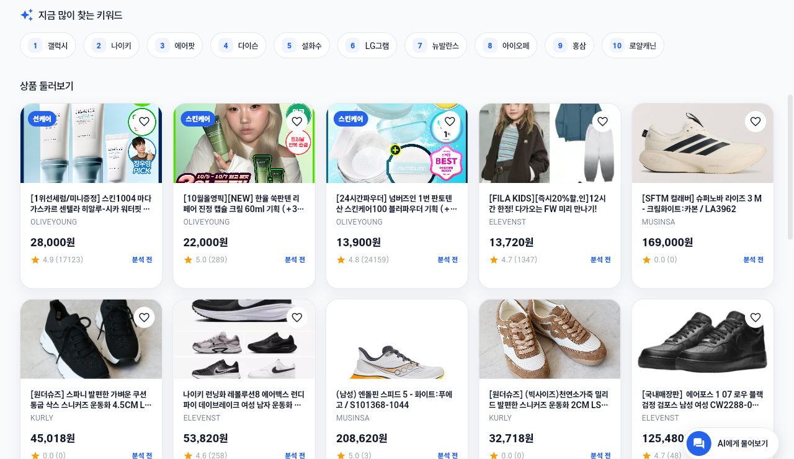
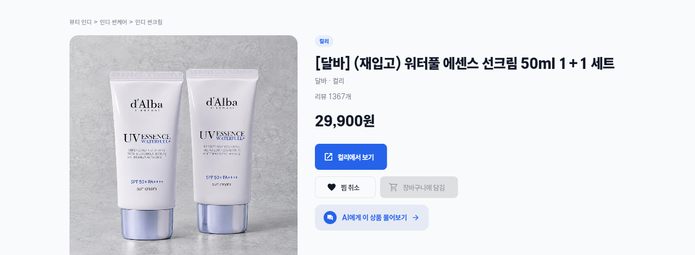
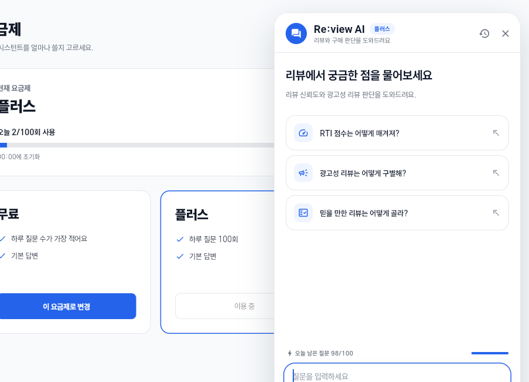
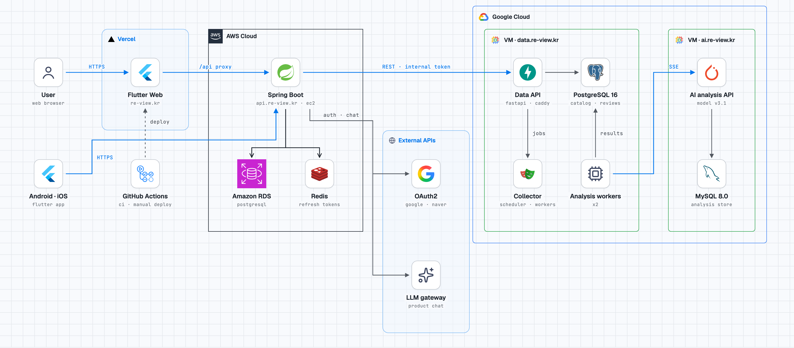

<p align="center">
  
</p>

<h1 align="center">Re:view</h1>

<p align="center">
  <b>실사용 리뷰로 상품을 고르는 쇼핑 신뢰도 분석 서비스</b><br />
  상품 탐색 → 리뷰·분석 확인 → 가격 비교 → 상품 문맥 채팅까지 한 흐름으로 이어집니다.
</p>

<p align="center">
  
  
  
  
  
  
</p>

<p align="center">
  <a href="https://re-view.kr">운영 웹</a> ·
  <a href="#서비스-구성">서비스 구성</a> ·
  <a href="#빠른-시작">빠른 시작</a> ·
  <a href="#주요-기능">주요 기능</a> ·
  <a href="#배포와-ci">배포와 CI</a> ·
  <a href="#데이터-계약">데이터 계약</a>
</p>

| 홈: 실제 상품 목록 | 상품 v2 상세 | 계정·플랜 |
| --- | --- | --- |
|  |  |  |

<sub>2026-10-06 검증 당시 웹 화면입니다. 상품·가격·사용량은 서버 응답에 따라 달라집니다.</sub>

## 한눈에 보기

- **무엇을 하나요?** 여러 쇼핑몰 상품을 검색하고, 리뷰 신뢰도 분석 결과와 가격을 비교한 뒤, 찜·장바구니·상품 문맥 채팅으로 탐색을 이어갑니다.
- **이 저장소는?** Flutter 프론트엔드입니다. 하나의 코드로 웹·Android·iOS를 만들고, 데이터는 모두 Spring API에서 받습니다.
- **지금 상태는?** 웹은 [re-view.kr](https://re-view.kr)에서 운영 중이고, Android/iOS 앱은 출시 준비 중입니다.
- **분석 결과 원칙:** 분석되지 않은 상품은 **분석 전**으로 표시합니다. 값이 없는 것(null)과 실제 0점을 섞지 않습니다.

## 서비스 구성

<picture>
  <source media="(prefers-color-scheme: dark)" srcset=".github/readme/architecture-dark.png">
  
</picture>

| 구간 | 내용 |
| --- | --- |
| 클라이언트 → Spring | 웹(`re-view.kr`)은 Vercel이 `/api/*`·OAuth 경로를 `api.re-view.kr`로 프록시합니다. 앱은 `api.re-view.kr`을 HTTPS로 직접 호출합니다. |
| Spring API (AWS EC2) | nginx → Docker. PostgreSQL(RDS), Redis(리프레시 토큰), Google·네이버 OAuth2, 상품 채팅용 LLM 게이트웨이를 사용합니다. |
| Spring → Data API (GCP VM) | REST + 내부 토큰으로 카탈로그 동기화, 상품·검색·수집 job을 조회합니다. Data 서버는 스케줄러·수집기·분석 워커 ×2와 PostgreSQL 16을 둡니다. |
| Data → AI 분석 API (GCP VM) | `POST /api/v1/data/analyze/stream`을 SSE로 호출합니다(내부 토큰). 현재 분석 모델은 v3.1입니다. |

분석 결과는 웹훅으로 밀어주지 않습니다. Spring이 상품을 조회할 때 Data API에서 함께 받아 프론트로 전달합니다. 프론트는 Spring API만 호출합니다.

<details>
<summary>텍스트로 보기</summary>

```text
re-view.kr (Vercel, Flutter Web)          Android / iOS 앱
  │ /api/* · /oauth2/* 프록시                 │ HTTPS 직접 호출
  ▼                                          ▼
api.re-view.kr  Spring Boot API ── AWS EC2 (nginx → Docker)
  ├─ PostgreSQL (RDS) · Redis (리프레시 토큰)
  ├─ Google · Naver OAuth2
  ├─ LLM 게이트웨이 (상품 채팅 답변)
  │
  │ REST + 내부 토큰 (카탈로그 동기화, 상품·검색·수집 job 조회)
  ▼
data.re-view.kr  Data API ── GCP VM (Docker Compose, Caddy)
  ├─ 스케줄러 → 수집 워커 (쇼핑몰 상품·리뷰 수집)
  ├─ 분석 워커 ×2 · PostgreSQL 16
  │
  │ POST /api/v1/data/analyze/stream → SSE 응답 (내부 토큰)
  ▼
ai.re-view.kr  AI 분석 API ── GCP VM (MySQL 8.0)
```

</details>

## 빠른 시작

**필요한 것:** Flutter **3.44.2** / Dart **3.12.2** (`pubspec.yaml`은 Dart `^3.11.4` 요구). 명령은 저장소 루트 기준입니다.

```bash
flutter pub get
flutter devices          # 실행할 기기 ID 확인
```

| 실행 대상 | 명령 | 준비물 |
| --- | --- | --- |
| 웹 | `flutter run -d chrome` | - |
| Android 에뮬레이터 | `flutter emulators` → `flutter run -d <기기 ID>` | Android SDK, JDK 17 |
| iOS 시뮬레이터 | `cd ios && pod install && cd ..` → `open -a Simulator` → `flutter run -d <기기 ID>` | macOS, Xcode, CocoaPods |
| 실기기 | `flutter run -d <기기 ID>` | Android: USB 디버깅 / iOS: 개발자 모드·Xcode 서명 팀 |

- 기본 API 주소는 `https://api.re-view.kr`입니다. 로컬 웹도 이 주소에 직접 연결합니다.
- 운영 웹은 같은 출처의 `/api/*`를 호출하고 `vercel.json` rewrite로 API 서버에 넘깁니다. `flutter run`은 이 프록시를 제공하지 않습니다.
- 위는 실행 안내입니다. 네이티브 실기기 동작 검증 결과는 아닙니다.

### 설정 파일로 실행

여러 설정값은 `config/`의 JSON 파일로 한 번에 넘깁니다.

```bash
flutter run --dart-define-from-file=config/prod.json          # 운영 주소

cp config/local.example.json config/local.json                # 로컬 백엔드용 (git에 안 올라감)
flutter run --dart-define-from-file=config/local.json
```

한 값만 바꿀 때는 `--dart-define`을 씁니다. 값을 바꾼 뒤에는 앱을 다시 실행합니다. `.env` 자동 로드는 없습니다.

```bash
flutter run -d chrome --dart-define=API_BASE_URL=https://api.re-view.kr
```

<details>
<summary>로컬 백엔드 주소 예시</summary>

개발 PC에서 따로 띄운 백엔드에 연결할 때의 예시입니다. `PORT`는 실제 포트로 바꿉니다. 이 저장소에는 로컬 백엔드 실행 설정이 없습니다.

| 실행 환경 | `API_BASE_URL` 예시 |
| --- | --- |
| 같은 PC의 웹 브라우저 | `http://localhost:PORT` |
| Android Emulator | `http://10.0.2.2:PORT` |
| iOS Simulator | `http://127.0.0.1:PORT` |
| Android / iOS 실기기 | `http://<PC의_LAN_IP>:PORT` |

실기기의 `localhost`는 휴대폰 자신을 가리킵니다. PC와 같은 네트워크에서 접근 가능한 주소를 쓰고, 서버의 바인딩·방화벽·CORS를 확인합니다. HTTP 주소는 예시이며 현재 네이티브 보안 설정에서 접속을 검증하지 않았습니다.

</details>

<details>
<summary>환경변수 전체 목록 (<code>lib/core/config/app_config.dart</code>)</summary>

`API_BASE_URL`에는 `/api`를 붙이지 않습니다. 각 경로 기본값에 이미 `/api`가 들어 있습니다. 로컬 웹으로 판단하는 호스트는 `localhost`, `127.0.0.1`, `::1`, `*.localhost`입니다.

| 키 | 용도 | 생략 시 기본값 |
| --- | --- | --- |
| `API_BASE_URL` | API 루트 주소 | 운영 웹: 현재 origin, 로컬 웹·앱: `https://api.re-view.kr` |
| `HOME_DASHBOARD_PATH` | 홈 대시보드 | `/api/dashboard` |
| `SEARCH_PATH` | 상품 검색 | `/api/products` |
| `PRODUCT_PATH` | 기존 상품 조회 | `/api/products` |
| `ANALYSIS_PATH` | 상품 분석 | `/api/analysis/product` |
| `ANALYSIS_HEALTH_PATH` | 분석 상태 확인 | `/api/analysis/health` |
| `LOGIN_PATH` | 이메일 로그인 | `/api/auth/login` |
| `SIGNUP_PATH` | 회원가입 | `/api/auth/signup` |
| `LOGOUT_PATH` | 로그아웃 | `/api/auth/logout` |
| `GOOGLE_OAUTH_PATH` | Google 로그인 시작 | `/oauth2/authorization/google` |
| `NAVER_OAUTH_PATH` | 네이버 로그인 시작 | `/oauth2/authorization/naver` |
| `USER_ME_PATH` | 현재 사용자 | `/api/users/me` |
| `USER_SETTINGS_PATH` | 사용자 설정 | `/api/users/me/settings` |
| `CHAT_BASE_PATH` | 채팅·사용량 | `/api/chat` |
| `NOTIFICATION_BASE_PATH` | 알림함 | `/api/notifications` |
| `REPORT_BASE_PATH` | 리뷰 신고 | `/api/reports` |

</details>

## 주요 기능

| 영역 | 기능 |
| --- | --- |
| 탐색 | 상품 검색, 카테고리 탐색(경로 표시), 필터·정렬·페이지 상태를 주소에 저장, 휴대폰 필터 시트, 리뷰 있는 상품만 홈 둘러보기 |
| 상품 | 기존 상품·외부 상품 v2 상세, 섹션 바로가기, 리뷰 페이징, 이미지 갤러리(확대 렌즈), 상세 설명(서버 제공 시), 가격 비교 |
| 분석 | 리뷰엉이 안내, 수집·분석 진행 단계, AI 분석 요약 카드, 신뢰도 리포트(점수 출처·세부 점수·근거), 분석 전·계산 불가 구분 |
| 오류 | 오류 종류별 안내(연결·시간 초과·로그인 만료·요청 제한·서버), 다시 시도, 조회 요청만 1회 자동 재시도 |
| 저장 | 찜·장바구니, 최근 본 상품 |
| 계정 | 이메일 로그인·회원가입·비밀번호 재설정, 웹 Google/네이버 OAuth, 온보딩, 플랜·사용량, 회원 탈퇴 |
| 채팅 | 일반·프로 상품 문맥 채팅과 대화 기록 |
| 기타 | 리뷰 신고·피드백·알림함, 설정·움직임 줄이기, 관리자(리뷰·신고·사용자·배너) |
| 결제 | 웹 전용 TEST 결제 화면과 서버 계약 경계(키·API 미설정 시 비활성) |

공통 헤더와 검색 상태를 유지한 채 본문만 바뀝니다. 설정의 **움직임 줄이기**를 켜면 전환·카드·갤러리 효과와 반복 로딩 모션이 줄어듭니다. 모바일 웹에서는 헤더·필터·상품 카드·채팅 패널이 화면 폭에 맞춰 배치됩니다.

<details>
<summary>왜 이렇게 만들었나 (Problem / Solution)</summary>

| Problem | Solution |
| --- | --- |
| 여러 쇼핑몰 상품과 리뷰를 오가며 비교해야 함 | 상품 검색·상세·가격 비교·저장 기능을 공통 탐색 흐름으로 연결 |
| 분석 결과가 없는 상품을 점수만으로 판단하기 어려움 | null은 분석 전, 실제 0점은 0점으로 구분 |
| 상품 맥락을 대화에 다시 설명해야 함 | 외부 상품 식별자를 유지해 상품 문맥 채팅으로 전달 |
| 비동기 수집·검색 중 결과 상태를 알기 어려움 | 수집 대기·로딩·실패·재시도와 리뷰 더 불러오기 제공 |

</details>

## 플랫폼 지원

| Platform | 상태 | 최소 버전·설정 |
| --- | --- | --- |
| Web | [re-view.kr](https://re-view.kr) 운영 | Flutter Web. 최소 브라우저 버전은 정하지 않음 |
| Android | 출시 준비 중 | `minSdk = flutter.minSdkVersion` (Flutter 3.44.2 기본 API 24, 프로젝트에서 고정하지 않음) |
| iOS | 출시 준비 중 | `IPHONEOS_DEPLOYMENT_TARGET` iOS 13.0 (Podfile 전역 platform 선언은 주석 상태) |

Android·iOS는 CI의 debug 빌드로만 확인했습니다. 실기기 화면 검증은 별도입니다.

<details>
<summary>앱에서만 다르게 동작하는 부분</summary>

`kIsWeb` 분기로 앱에서만 동작하며, 웹 동작은 바꾸지 않았습니다.

- **로그인 세션:** refreshToken을 보안 저장소(`flutter_secure_storage`)에 두고 refresh 때마다 교체합니다. 읽기에 실패하면 로그아웃 상태로 시작하고, 쓰기에 실패하면 이전 값이 남지 않게 지웁니다.
- **화면:** 본문 SafeArea, 시스템 글자 크기 최대 1.6배, hover 전용 강조 대신 터치 피드백, Android 뒤로 가기로 채팅 패널 먼저 닫기
- **당겨서 새로고침:** 홈, 검색 결과, 알림함, 찜 목록
- **이미지:** 축소 썸네일 주소를 먼저 쓰고 실패하면 원본으로 대체
- **외부 링크:** 외부 쇼핑몰·가격 비교 링크는 외부 브라우저로 엽니다.
- **오류:** 처리되지 않은 예외는 release 빌드에서 기본 오류 화면으로 대체하며, 원격 수집은 하지 않습니다.
- **결제:** 웹 전용 TEST 결제 진입은 앱에서 숨깁니다.
- **시작 화면·아이콘:** Re:view 로고를 씁니다.
- **서명:** Android release 빌드는 `android/key.properties`가 있으면 그 키로, 없으면 debug 키로 서명합니다. 키 파일은 저장소에 올리지 않습니다.

아직 정하지 않은 것: 앱 식별자, 최소 OS 버전, 소셜 로그인 앱 흐름, 푸시 알림, 딥링크, 앱 결제, 개인정보 처리방침 본문.

</details>

## 기술 스택과 구조

| 영역 | 기술·구성 |
| --- | --- |
| Client | Flutter / Dart, Web·Android·iOS 프로젝트 |
| State / DI | `flutter_riverpod` |
| Navigation | `go_router`, 공통 shell·인증 라우팅 |
| HTTP | `dio`, 수동 DTO 파싱, 공통 `Result` / `Failure` |
| Storage | `flutter_secure_storage`, `shared_preferences`, 웹·네이티브 조건부 구현 |
| UI | Material, Freesentation, `shimmer`, `flutter_typeahead` |
| Localization | `flutter_localizations`, `intl`, ARB (ko·en·ja·zh) |
| Utilities | `url_launcher`, `file_picker` |
| Tests | `flutter_test`, `mocktail` |
| Web Deployment | GitHub Actions, Vercel CLI, rewrite·SPA fallback |

기능마다 data / domain / presentation 계층을 나눕니다. DTO는 직접 파싱하고, 오류는 공통 `Result`·`Failure`로 넘깁니다.

```text
lib/
├── main.dart                    # 저장소 초기화·앱 시작
├── app/                         # shell·router·반응형 배치·테마·모션
├── core/                        # 설정·네트워크·저장소·공통 provider
├── features/
│   └── <feature>/
│       ├── data/                # datasource·DTO·repository 구현
│       ├── domain/              # entity·repository·use case
│       └── presentation/        # page·widget·provider·view model
├── shared/                      # 공통 위젯·상수·확장
└── l10n/                        # ARB·생성된 번역 코드

test/                            # 도메인·데이터·상태·위젯 회귀 검증
```

주요 기능 폴더: `home`, `search`, `product_detail`, `external_product`, `auth`, `chat`, `plan`, `my_page`, `wishlist`, `cart`, `review_report`, `notifications`, `settings`, `admin`. 기능마다 필요한 계층만 둡니다.

## 인증과 통신

모든 인증 요청은 `Authorization: <tokenType> <accessToken>` 헤더를 붙입니다. 일반 API가 401을 받으면 토큰을 한 번 갱신하고 원래 요청을 다시 보냅니다.

```text
일반 API 요청 401
  └─ POST /api/auth/refresh
       ├─ 웹: 본문 없음(쿠키)
       ├─ 앱: X-Client-Platform: app, 본문 {"refreshToken"} → 응답의 refreshToken으로 교체
       ├─ 새 accessToken·tokenType 저장 → 원래 요청 1회 재시도
       └─ refresh가 401 → 세션 만료 처리 (그 밖의 실패는 세션 유지)
```

<details>
<summary>세부 규칙</summary>

- 동시에 401이 여러 개 나면 진행 중인 refresh 요청 하나를 같이 씁니다.
- `/api/auth/*`, 토큰 없는 요청, 이미 재시도한 요청은 다시 갱신하지 않습니다.
- 앱은 로그인·회원가입 응답의 `refreshToken`을 저장해 refresh·로그아웃 본문에 넣습니다. 저장된 값이 없으면 바로 로그아웃 상태가 됩니다. 앱을 다시 켤 때도 같은 방식으로 세션을 복구합니다.
- OAuth는 웹 리다이렉트로만 구현돼 있고, 네이티브 앱 이동은 아직 지원하지 않습니다.
- 상품 채팅: `POST /api/chat/messages`(일반), `POST /api/chat/pro/messages`(프로) → JSON 응답

</details>

## 배포와 CI

PR과 `develop` 머지는 **검사만** 하고 배포하지 않습니다. 운영 배포는 작업을 모두 마친 뒤 최종 SHA를 지정해 수동으로 한 번 실행합니다. main 릴리스·태그는 별도 QA 조건을 따릅니다.

| 워크플로 | 언제 | 하는 일 |
| --- | --- | --- |
| `vercel-deploy.yml` → `deploy-preview` | 모든 PR, `develop` push | `flutter analyze`, `flutter test`, release 웹 빌드, 공백 검사. 배포 없음 |
| `vercel-deploy.yml` → `deploy-production` | 수동 실행(`commit_sha` 입력) | SHA 재확인 → 배포 표식 작성 → `build/web`을 production에 1회 배포 |
| `mobile-build.yml` | `lib/`, `assets/`, `android/`, `ios/`, `l10n.yaml`, `pubspec` 변경 PR, 수동 실행 | `flutter build apk --debug`, `flutter build ios --debug --no-codesign`. 배포·서명 없음 |
| Vercel Git integration | - | `git.deploymentEnabled:false`로 자동 배포 차단 |

<details>
<summary>운영 배포 절차</summary>

1. Actions에서 `Validate Flutter Web and Final Deployment`를 고르고, `develop`의 최종 40자리 SHA를 `commit_sha`에 넣어 실행합니다.
2. 배포 후 아래 응답을 확인합니다. 기대값은 HTTP 200, `Cache-Control: no-store`, 그리고 본문의 `commitSha`가 지정한 SHA·최종 `origin/develop`과 같은 것입니다.

```bash
curl -i https://re-view.kr/deployment.json
```

참고:
- `deploy-preview`라는 검사 이름은 호환을 위해 남겼지만, 실제로는 배포 없는 검증입니다.
- 자동 PR preview와 자동 production 배포는 하지 않습니다. 루트와 웹 배포 설정 모두 `git.deploymentEnabled:false`를 유지합니다.
- `Ignored Build Step`으로 취소해도 배포 한도가 소비되므로 자동 배포 차단 대안으로 쓰지 않습니다.
- 양쪽 설정은 `/api`, OAuth 시작·콜백을 API 서버로 연결하고 SPA fallback을 제공합니다. 서버 CORS 때문에 preview 도메인의 실제 로그인은 운영과 다를 수 있습니다.
- Vercel Git의 `build.sh`는 Flutter가 없으면 **3.44.0**을 설치합니다. Actions는 **3.44.2**를 씁니다.

</details>

## 데이터 계약

<details>
<summary>상품 목록·검색·식별자</summary>

- 홈 상품 목록은 `GET /api/products`(최대 100건, 홈용 표본)를 씁니다. 리뷰가 있는 상품만 "상품 둘러보기"에 보여줍니다. `GET /api/dashboard`의 추천·RTI 섹션은 아직 별도 서버 샘플 데이터입니다.
- 검색 `GET /api/products?keyword=...`는 컬리·올리브영·무신사·11번가에서 몰당 최대 10건, 총 최대 40건을 돌려줍니다. 보통 1~2초 걸리고, 이전 검색 응답이 새 결과를 덮지 않게 합니다.
- 카테고리 화면은 서버 카테고리 조회 API가 생기기 전까지 카테고리 이름으로 검색한 결과를 카테고리로 걸러 보여줍니다([review-backend#248](https://github.com/FireViewLab/review-backend/issues/248)).
- 목록의 `externalId`, `dataPlatform`, `dataProductId`를 상세 이동과 채팅까지 유지합니다. 필드쌍이 있으면 `/product/:platform/:productId`, 외부 식별자가 없는 기존 상품은 `/product/:id`로 이동합니다. `externalId`만 있으면 첫 `-`로 나누고, 상품 ID 안의 `-`·공백·슬래시는 안전하게 인코딩합니다.
- 찜·장바구니 요청은 기존 숫자 상품 ID를 씁니다. 상품 채팅에는 원본 `externalId`를 먼저 보내고, 필드쌍만 있으면 `{platform}-{productId}`를 만듭니다. 외부 정보 없는 상품의 숫자 ID는 외부 채팅 식별자로 보내지 않습니다.
- 카테고리는 서버 enum과 공식 표시명을 쓰고 `subCategory`는 몰 원문으로 따로 표시합니다. 해석할 수 없는 분류는 추정하거나 필터에서 빼지 않고 안내와 함께 유지합니다.

</details>

<details>
<summary>v2 상세와 분석 전 상태</summary>

- v2 화면은 `GET /api/v2/products/:platform/:productId`를 조회합니다.
- `QUEUED`일 때의 `product: null`과 수집 job을 유지하고, job을 3초 간격으로 확인합니다. 수집 완료 시간은 보장하지 않습니다.
- 상품 정보가 준비되면 리뷰 수집이 끝났는지와 상관없이 바로 보여줍니다. 30초 뒤 대기 안내, 120초 제한과 재시도를 제공합니다.
- 리뷰는 `nextCursor`로 더 불러옵니다. 중복 리뷰와 반복·순환 cursor를 막고, 실패해도 기존 내용은 남깁니다.
- RTI·등급·색상이 null이면 **분석 전**입니다. 0점은 실제 0점으로 표시하고, 미분석을 안전 등급·초록색·가짜 수치로 바꾸지 않습니다.
- RTI 평균은 미분석을 빼고 계산하며, 전부 미분석이면 분석 전입니다. 미분석 상품은 양수 RTI 필터를 통과하지 않고 정렬에서 뒤로 갑니다.
- 리뷰 수·평점의 null은 숨기고 명시적인 0은 표시합니다.

</details>

<details>
<summary>로그인·계정·플랜·채팅</summary>

- OAuth 시작 경로는 `/oauth2/authorization/{google,naver}`, 서버 콜백은 `https://re-view.kr/login/oauth2/code/{google,naver}`입니다. 인증이 필요한 화면은 로그인 상태에 따라 이동을 막습니다.
- 플랜 변경은 `PATCH /api/users/me/plan`에 `{"planTier":"FREE"|"PLUS"|"PRO"}`를 보냅니다. 돌려받은 플랜을 확인하고 `GET /api/users/me`, `GET /api/chat/quota`를 다시 받아 화면과 열린 채팅의 권한·한도를 갱신합니다. 실패·불일치·재조회 실패를 성공으로 표시하지 않습니다.
- `GET /api/plans`에는 의존하지 않고, 한도 수치는 서버 응답을 씁니다.
- 채팅은 서버 quota에 따라 프로 선택과 전송을 제어하고, `CHAT_PLAN_REQUIRED`·`CHAT_QUOTA_EXCEEDED`에 맞는 안내를 보여줍니다.

</details>

<details>
<summary>TEST 서비스 결제·장바구니 TEST 주문</summary>

**TEST 서비스 결제** (`/plan` → `/payments/test`)

- 토스페이먼츠 v2 주문서형 SDK를 연결한 웹 전용 TEST 흐름입니다. 서버 주문/승인 API·가격·상점 TEST 공개키가 아직 없어 결제 시작은 비활성 상태입니다. 직접 플랜 변경과는 별개입니다.
- 계약이 정해지면 공개 `TOSS_TEST_CLIENT_KEY`(`test_gck_`만 허용)와 `PAYMENT_TEST_CATALOG_PATH`, `PAYMENT_TEST_ORDERS_PATH`, `PAYMENT_TEST_CONFIRM_PATH`를 빌드 define으로 넣습니다. 이 경로들은 지금 있는 API가 아니라 합의한 계약을 지정하는 자리입니다.
- 서버가 준 TEST offer·가격·무작위 고객키·주문만 SDK로 넘깁니다. 요청/응답 본문 로깅은 없앴습니다. secretKey와 서버 간 토큰은 프론트에 넣지 않습니다.
- SDK success callback은 성공 확정이 아닙니다. 프론트는 주문을 조회해 orderId/금액을 비교한 뒤 자체 서버 승인 API만 부릅니다. 서버는 주문 소유자·금액·TEST 모드 검증과 중복 승인 방지를 해야 합니다.
- `PAID` 응답만 승인으로 표시하고, TEST 결제로 실제 플랜·quota를 바꾸지 않습니다. 실패·취소는 미완료 안내, 승인 timeout은 상태 조회, callback 새로고침은 서버 상태부터 조회합니다.
- 공식 문서: [SDK 초기화](https://docs.tosspayments.com/sdk/v2/js/environment), [주문서형 SDK](https://docs.tosspayments.com/sdk/v2/js/payment-widget), [인증·승인 흐름](https://docs.tosspayments.com/guides/v2/get-started/payment-flow). 실제 결제 실행과 화면 테스트는 미검증입니다.

**장바구니 선택 상품 TEST 주문** (`/cart` → `/cart/checkout`)

- 주소 입력, 서버 견적(선택 항목·수량·확정 가격·배송비·판매자/배송 가능 여부) 검증, TEST 주문 생성·토스 위젯·콜백 복구 경계를 연결했습니다.
- 공개 TEST 키와 주문·판매·배송·승인 API가 없어 주소 전송·주문 저장·결제는 비활성입니다. 외부몰 상품을 실제 주문 가능한 것처럼 보이거나 가짜 성공으로 처리하지 않습니다.
- 계약이 정해지면 `CART_TEST_QUOTES_PATH`, `CART_TEST_ORDERS_PATH`, `CART_TEST_CONFIRM_PATH`와 공개 `TOSS_TEST_CLIENT_KEY`를 설정합니다.
- 서버 견적은 `purpose:CART`, `testOnly:true`, `currency:KRW`, 항목별 상품/수량/확정 가격, 상품합계·배송비·총액을 줘야 합니다. 주문은 같은 견적 ID와 TEST 금액을 유지하고, 승인 때 선택 수량만 처리한 `cartReconciled:true`를 돌려줘야 합니다.
- 프론트는 장바구니 전체를 임의로 지우지 않고 서버 상태를 다시 조회합니다. 주소는 메모리에만 두고 계정이 바뀌면 비웁니다. TEST 승인은 실제 배송·실결제 완료를 뜻하지 않습니다.

</details>

## 검증과 남은 일

```bash
flutter analyze
flutter test
flutter build web --release
bash scripts/write-deployment-marker.sh
```

- 메모리가 작은 환경에서는 전체 테스트와 릴리스 빌드를 순서대로 실행합니다.
- 운영 API는 실제 데이터를 바꿀 수 있으니, QA에는 허용된 테스트 계정·상품을 쓰고 원래 상태로 되돌립니다.
- 서버 간 인증 토큰, 계정 정보, 민감 로그는 프론트 코드·빌드·공개 설정·커밋에 넣지 않습니다.

<details>
<summary>기존 QA 기록 (2026-10-06)</summary>

당시 **375 tests 통과**, release 웹 빌드 성공, analyze는 기존 관리자 info 3개 외 새 warning/error 없음. 당시 앱 코드의 결과이며 지금 변경에 대한 새 실행 결과가 아닙니다.

| 환경 | 확인 범위 |
| --- | --- |
| 단위·위젯/mock | 외부 식별자 필드쌍/externalId/기존 상품·큰 숫자 ID, null과 실제 0, QUEUED→완료, 리뷰 cursor, 플랜 응답 실패·불일치·열린 채팅 갱신, 한도/프로 오류, 최초 포커스, 움직임 줄이기 |
| 로컬 릴리스 웹 + 운영 API·기존 로그인 세션 | 실제 외부 상품 찜·장바구니 추가/취소와 원상복원, v2 이동·리뷰 페이징·상품 채팅, FREE→PLUS→FREE 및 열린 채팅 quota, 모바일 배치 |
| 운영 웹·기존 로그인 세션 | 홈→v2 상세, 선크림 검색 40건·분석 전, 상품 채팅 200, FREE→PLUS→FREE·서버 quota 갱신·복원, 모바일 플랜, 레이아웃/포커스 오류 없음 |

- FREE 계정의 남은 질문 2회를 UI에서 각각 200으로 처리했습니다. 서버 remaining 0/usedToday 5 이후 한도 안내와 입력·전송 비활성, 추가 요청 차단을 확인했습니다.
- 운영 API는 일반 요청 `429 CHAT_QUOTA_EXCEEDED`, 프로 요청 `403 CHAT_PLAN_REQUIRED`를 돌려줬고, 거절된 요청은 사용량을 늘리지 않았습니다.
- 소셜 재인증/OAuth 콜백, 신고·투표 실제 제출, 갤러리 전용 브라우저, 실제 PRO 대화는 실계정으로 검증하지 않았습니다. mock 검증을 실계정 완료로 보지 않습니다.

기존 화면 캡처:

| 화면 | 경로·역할 | 캡처 |
| --- | --- | --- |
| 홈 | `/` — 상품·카테고리 탐색 | [데스크톱](.github/qa/2026-10-06/home-desktop.png) · [모바일 웹](.github/qa/2026-10-06/home-mobile.png) |
| 상품 상세 | `/product/:id`, `/product/:platform/:productId` | [데스크톱](.github/qa/2026-10-06/product-desktop.png) · [모바일 웹](.github/qa/2026-10-06/product-mobile.png) |
| 플랜 | `/plan` — 현재 플랜·사용량 | [데스크톱](.github/qa/2026-10-06/plan-desktop.png) · [모바일 웹](.github/qa/2026-10-06/plan-mobile.png) |
| 로그인 | `/login` — 이메일·소셜 로그인 | [데스크톱](.github/qa/2026-10-07/login-desktop.png) · [모바일 웹](.github/qa/2026-10-07/login-mobile.png) |
| 상품 채팅 | 상품 화면의 채팅 패널 | [데스크톱](.github/qa/2026-10-07/product-chat-desktop.png) · [모바일 웹](.github/qa/2026-10-07/product-chat-mobile.png) |

</details>

### 남은 일

- 서버 대기:
  - 인기 검색어 실제 집계([review-backend#247](https://github.com/FireViewLab/review-backend/issues/247))
  - 카테고리·페이지 조회([#248](https://github.com/FireViewLab/review-backend/issues/248))
  - v2 상세 설명·상품 단위 분석 요약([#249](https://github.com/FireViewLab/review-backend/issues/249))
  - 분석 모델 v3.1 결과 필드 전달([#250](https://github.com/FireViewLab/review-backend/issues/250))
- `GET /api/dashboard`의 실제 상품 전환은 서버 후속 작업입니다. 더미 33건 삭제는 대시보드 전환 이후 서버가 진행합니다.
- 오늘의집·네이버·에이블리 검색은 수집기 문제로 현재 검색 계약에서 빠져 있습니다.
- 실결제/live 키, 다크 모드, 추가 수집기 구현은 이번 범위 밖입니다.
- v1.1.0은 필요한 실계정 QA를 마친 뒤 main 릴리스 PR·태그·릴리스 순서로 진행합니다. 검증 환경이 없는 항목은 제한으로 남기고 완료로 표시하지 않습니다.

관련 서버 계약: [플랜 #177](https://github.com/FireViewLab/review-backend/issues/177), [실상품 목록 #179](https://github.com/FireViewLab/review-backend/issues/179), [상세 보강 #181](https://github.com/FireViewLab/review-backend/issues/181). 프론트 반영: [#246](https://github.com/FireViewLab/review-frontend/pull/246), [#247](https://github.com/FireViewLab/review-frontend/pull/247).
